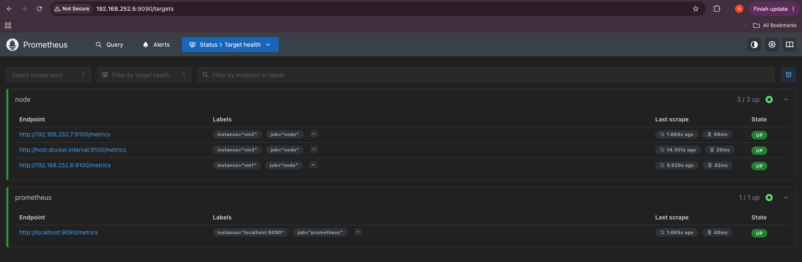
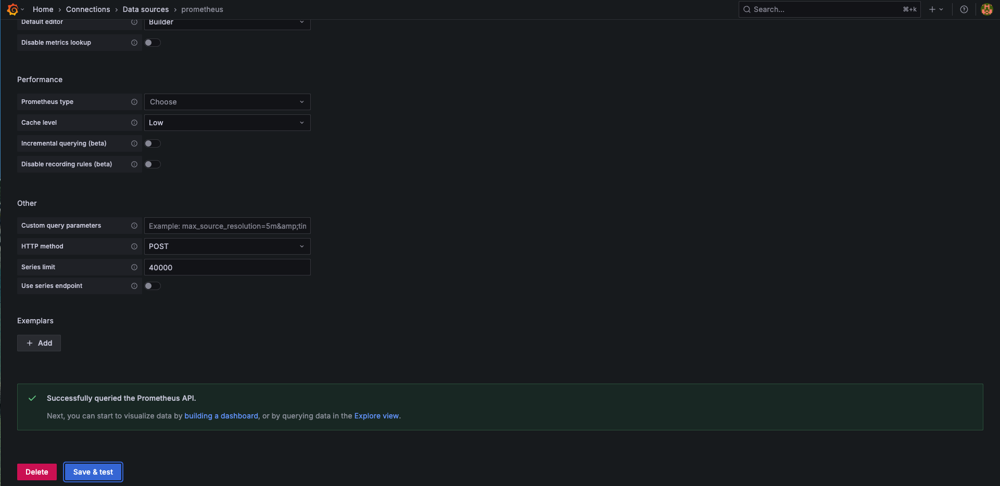
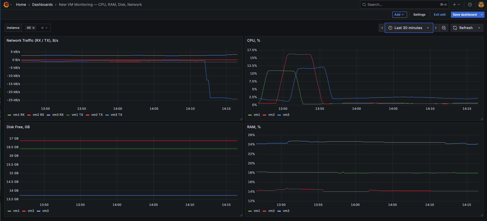
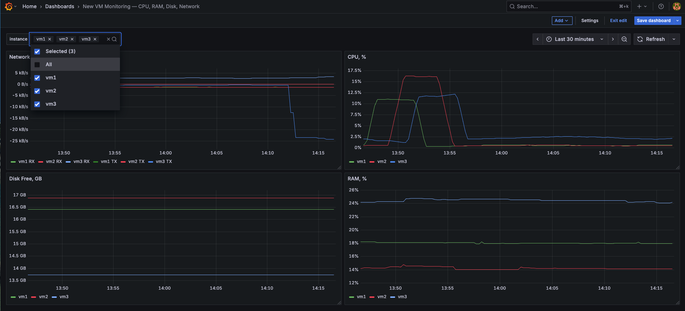

# Мониторинг виртуальных машин и Docker-образы для backend-приложения

В проекте реализованы две задачи:

1. Настройка мониторинга виртуальных машин с использованием Node Exporter, Prometheus и Grafana.
2. Создание и сравнение трёх вариантов Docker-образа для Python-приложения `counter-backend`.

## 1. Мониторинг виртуальных машин

### 1.1. Архитектура мониторинга

Для сбора и визуализации метрик используются:

- **Node Exporter** — сбор системных метрик виртуальных машин.
- **Prometheus** — сбор и хранение метрик.
- **Grafana** — визуализация метрик.

Мониторинг настроен для трёх виртуальных машин:

| ВМ | Адрес Node Exporter |
|---|---|
| vm1 | `192.168.252.6:9100` |
| vm2 | `192.168.252.7:9100` |
| vm3 | `host.docker.internal:9100` |

Схема взаимодействия:

```text
vm1 ── Node Exporter ──┐
vm2 ── Node Exporter ──┼── Prometheus ── Grafana
vm3 ── Node Exporter ──┘
```

### 1.2. Запуск мониторинга

```bash
cd monitoring
sudo docker compose up -d
sudo docker compose ps
```

Сервисы доступны по адресам:

| Сервис | Адрес |
|---|---|
| Prometheus | `http://localhost:9090` |
| Grafana | `http://localhost:3000` |
| Node Exporter | `http://localhost:9100/metrics` |

Адреса виртуальных машин относятся к локальному стенду Multipass и могут изменяться при пересоздании ВМ.

### 1.3. Проверка Node Exporter

Проверка получения системных метрик:

```bash
curl -s http://localhost:9100/metrics | grep '^node_' | head
```

Node Exporter возвращает метрики с префиксом `node_`, включая информацию о процессоре, оперативной памяти, диске и сети.

**Лог:** [node-exporter-metrics.txt](monitoring/evidence/node-exporter-metrics.txt)

### 1.4. Проверка Prometheus

В Prometheus настроен сбор метрик с трёх виртуальных машин.

Для каждой цели задана метка `instance`, позволяющая различать виртуальные машины.

В интерфейсе Prometheus по адресу `http://localhost:9090/targets` все три цели находятся в состоянии **UP**.



### 1.5. Подключение Grafana к Prometheus

В Grafana добавлен источник данных Prometheus.

Подключение проверено через **Connections → Data sources → Save & test**.



### 1.6. Дашборд мониторинга

Создан собственный дашборд с четырьмя панелями.

**CPU Usage**

Отображает загрузку процессора в процентах без учёта времени простоя (`idle`).

**RAM Usage**

Отображает процент используемой оперативной памяти.

**Disk Free**

Отображает доступное место на корневой файловой системе.

**Network Traffic**

Отображает входящий и исходящий сетевой трафик.



### 1.7. Переменная instance

Для переключения между виртуальными машинами создана переменная `instance`.

Она позволяет:

- Выбрать одну виртуальную машину.
- Выбрать несколько виртуальных машин.
- Отобразить метрики всех виртуальных машин одновременно.

Во всех панелях используется фильтрация по выбранному значению `instance`.



Дашборд экспортирован в JSON.

**Экспорт:** [dashboard.json](monitoring/evidence/dashboard.json)

### 1.8. Результат

Настроен мониторинг трёх виртуальных машин. Prometheus успешно собирает системные метрики, а Grafana отображает загрузку CPU, использование RAM, свободное место на диске и сетевой трафик.

Переменная `instance` позволяет сравнивать показатели разных виртуальных машин на одном дашборде.

---

## 2. Docker-образы для counter-backend

### 2.1. Описание приложения

`counter-backend` — HTTP-сервер на Python с использованием `aiohttp`.

Для управления зависимостями и сборки приложения используется Poetry.

Приложение предоставляет два API-метода:

| Метод | Endpoint | Назначение |
|---|---|---|
| GET | `/api/counter` | Возвращает текущее значение счётчика |
| POST | `/api/counter` | Увеличивает счётчик на единицу |

Для всех трёх вариантов используется базовый образ `python:3.11.6-slim-bookworm`.

### 2.2. Одноступенчатая сборка

Реализован `Dockerfile.single`.

В одном Docker-образе выполняются установка зависимостей, сборка приложения и его запуск.

Процесс приложения запускается от пользователя `root`.

Сборка:

```bash
cd counter-backend
sudo docker build -f Dockerfile.single -t counter-single .
```

### 2.3. Многоступенчатая сборка

Реализован `Dockerfile.multistage`.

На этапе сборки выполняются:

1. Установка Poetry, setuptools и wheel.
2. Экспорт зависимостей.
3. Сборка wheel-пакетов зависимостей.
4. Сборка wheel-пакета приложения.

В финальный образ переносится только каталог `dist`, содержащий собранные пакеты.

Зависимости устанавливаются из локальных wheel-файлов без обращения к внешним индексам пакетов.

Сборка:

```bash
sudo docker build -f Dockerfile.multistage -t counter-multistage .
```

### 2.4. Многоступенчатая сборка с непривилегированным пользователем

Реализован `Dockerfile.nonroot`.

Сборка выполняется аналогично многоступенчатому варианту.

Дополнительно в финальном образе создаётся пользователь `user` с UID/GID `1001`.

Приложение запускается от непривилегированного пользователя вместо `root`.

Сборка:

```bash
sudo docker build -f Dockerfile.nonroot -t counter-nonroot .
```

### 2.5. Запуск контейнеров

Для каждого образа запускается отдельный контейнер.

```bash
sudo docker run -d --name counter-single \
  -p 127.0.0.1:8080:8080 counter-single

sudo docker run -d --name counter-multistage \
  -p 127.0.0.1:8081:8080 counter-multistage

sudo docker run -d --name counter-nonroot \
  -p 127.0.0.1:8082:8080 counter-nonroot
```

| Контейнер | Порт |
|---|---|
| counter-single | 8080 |
| counter-multistage | 8081 |
| counter-nonroot | 8082 |

### 2.6. Проверка работы API

Для каждого контейнера выполнены запросы GET и POST.

Проверены начальное значение счётчика, его увеличение и повторное чтение.

| Запрос | Ожидаемый ответ | HTTP-код |
|---|---|---|
| Первый GET | `{"count": 0}` | 200 |
| Первый POST | `{"count": 1}` | 201 |
| Второй POST | `{"count": 2}` | 201 |
| Повторный GET | `{"count": 2}` | 200 |

Проверки выполнены для всех трёх вариантов Docker-образа.

Также с помощью `docker exec ... id` проверен пользователь контейнера.

| Контейнер | Пользователь |
|---|---|
| counter-single | `uid=0(root)` |
| counter-multistage | `uid=0(root)` |
| counter-nonroot | `uid=1001(user)` |

**Полный лог выполнения проверок:** [checks.log](counter-backend/evidence/checks.log)

### 2.7. Сравнение размеров Docker-образов

Размеры образов получены командой:

```bash
sudo docker image ls \
  --format "table {{.Repository}}\t{{.Tag}}\t{{.Size}}"
```

| Образ | Размер |
|---|---:|
| `counter-single` | 362 MB |
| `counter-multistage` | 260 MB |
| `counter-nonroot` | 261 MB |

**Лог:** [size.txt](counter-backend/evidence/size.txt)

Многоступенчатая сборка позволила уменьшить размер образа с 362 MB до 260 MB — примерно на **28%**.

Добавление непривилегированного пользователя практически не повлияло на размер финального образа.

### 2.8. Результат

Собраны и проверены три варианта Docker-образа для одного приложения.

Все три варианта обеспечивают работу HTTP API и корректное изменение счётчика.

Многоступенчатая сборка позволила уменьшить размер образа, а вариант `nonroot` дополнительно обеспечивает запуск приложения без привилегий суперпользователя.

---

## Итоги

В первой части проекта настроена система мониторинга виртуальных машин на базе Node Exporter, Prometheus и Grafana. Создан дашборд для наблюдения за основными системными метриками с возможностью переключения между виртуальными машинами.

Во второй части реализованы три варианта Docker-образа для Python-приложения. Проверена работоспособность API, выполнено сравнение размеров образов и реализован запуск приложения от непривилегированного пользователя.

**Основные результаты:**

- Мониторинг трёх виртуальных машин.
- Четыре панели Grafana: CPU, RAM, Disk, Network.
- Переменная `instance` для выбора виртуальной машины.
- Три работающих Docker-образа.
- Проверки API и пользователей контейнеров.
- Уменьшение размера Docker-образа примерно на 28% благодаря многоступенчатой сборке.
